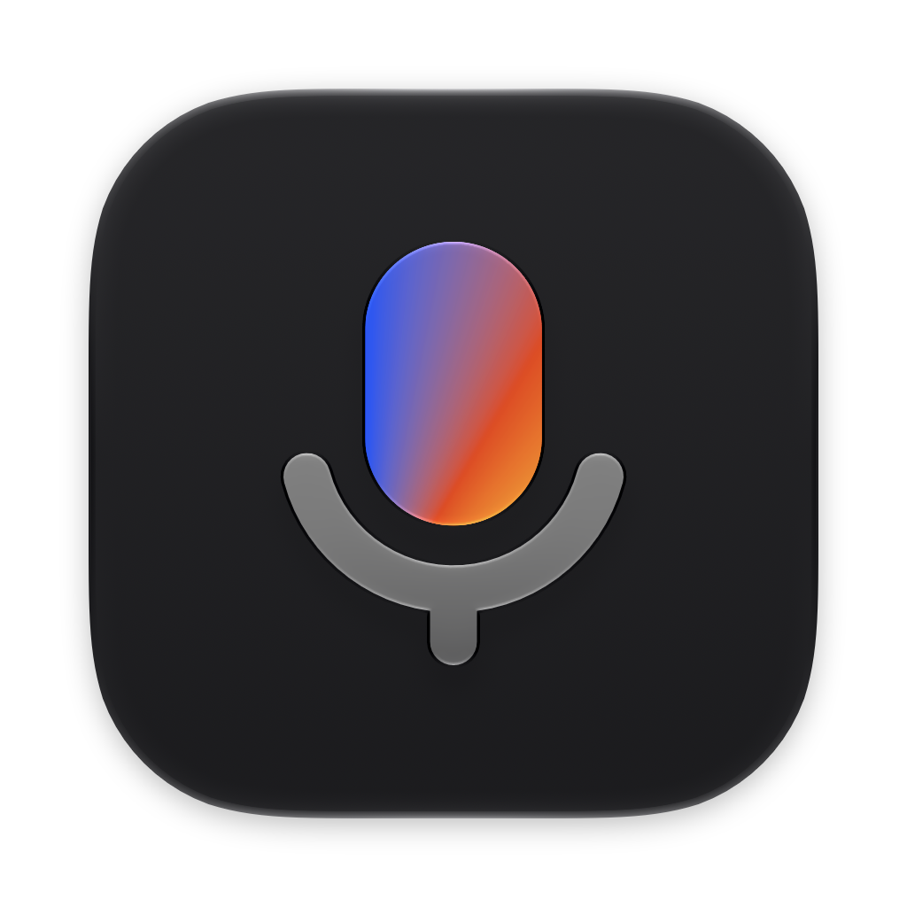

<p align="center">
  
</p>

<h1 align="center">Tony</h1>

<p align="center">
  <b>Hold a key. Speak. Let go.</b><br>
  Your words land where the cursor is, in any app, the moment you let go.<br>
  Free and open source dictation for the Mac. On device, private, and fast.
</p>

<p align="center">
  <a href="https://github.com/bestboyhq/tony/releases/latest"></a>
</p>

<p align="center">
  <a href="https://github.com/bestboyhq/tony/releases/latest"></a>
  
  
  
  <a href="LICENSE"></a>
</p>

<p align="center">
  <picture>
    <source media="(prefers-color-scheme: light)" srcset=".github/readme/hero-light.avif">
    
  </picture>
</p>

<p align="center">
  <sub>Tony's own pill, recorded from the app with nothing edited.
  A macOS voice speaks into it at the pace a mic would, Parakeet Ultra transcribes on the Neural Engine, and the text landed 63 ms after the voice stopped.
  Only the window behind it is a mock-up.</sub>
</p>

<p align="center">
  <b>~50 ms</b> per sentence&nbsp;&nbsp;·&nbsp;&nbsp;<b>5.8%</b> word error rate&nbsp;&nbsp;·&nbsp;&nbsp;<b>25</b> languages&nbsp;&nbsp;·&nbsp;&nbsp;<b>0</b> bytes of audio leave your Mac
</p>

<p align="center">
  <a href="https://bestboy.dev/tony">bestboy.dev/tony</a>&nbsp;&nbsp;·&nbsp;&nbsp;<a href="https://bestboy.dev/tony/docs">Docs</a>&nbsp;&nbsp;·&nbsp;&nbsp;If Tony saves you some typing, <a href="https://github.com/bestboyhq/tony">a star</a> helps other people find it.
</p>

---

## What is Tony?

Tony is dictation for the whole Mac.
Hold your key and talk, and the text lands where your cursor is, in any app, the moment you let go.

Talking is faster than typing, and the gap is widest where you type the most: prompts.
A coding agent or a chat box does better with the whole picture, and the whole picture is a lot to type.
With Tony you say it.

Most dictation clips your first word, waits on a server, pastes a "Thank you." you never said, or loses your words when the paste fails.
Tony is built so none of that can happen, on one of the most accurate open speech models there is, and your voice never leaves the Mac.

| Tony takes the place of | With |
| --- | --- |
| Typing a long prompt | Five minutes of talking that land about 100 ms after you let go. |
| A cloud dictation subscription | Parakeet Ultra on your Mac's Neural Engine: free, offline, and private. |
| Fixing names after every dictation | Your words, spelled your way: Tailscale, not "tail scale". |
| A language setting | 25 European languages, detected as you speak, even mid-sentence. |
| Deleting "um" | Filler words out in every language, with the commas and capitals kept. |
| Retyping a paste that never landed | Every dictation on your clipboard, and the last one in the menu bar. |

---

# Core features

## Talk for minutes, wait for none

A caption buds out of the pill and shows your words about half a second after you say them.
It keeps your last five lines and scrolls the rest away.
Tony transcribes at each pause while you talk, so letting go is as instant after a long ramble as after one sentence.

<p align="center">
  <picture>
    <source media="(prefers-color-scheme: light)" srcset=".github/readme/long-light.avif">
    
  </picture>
</p>

## Your words, spelled your way

Add the names, brands, and jargon you use, and "tail scale" lands as Tailscale.
A second, small model checks each one against your voice, so a word swaps in only where you said it.
Watch the caption: the model's first guess blurs into your word in place.

<p align="center">
  <picture>
    <source media="(prefers-color-scheme: light)" srcset=".github/readme/words-light.avif">
    
  </picture>
</p>

## 25 languages, detected as you speak

English, German, French, Spanish, Italian, Portuguese, Dutch, Polish, Ukrainian, Russian, Greek, and the rest of Europe.
Switch between them without a setting, even mid-dictation: where the model loses track of the switch, Tony transcribes each language on its own, so neither comes out garbled.
Punctuation, capitals, and accents included.

<p align="center">
  <picture>
    <source media="(prefers-color-scheme: light)" srcset=".github/readme/languages-light.avif">
    
  </picture>
</p>

## Fast and accurate, on your Mac

Tony runs Parakeet Ultra: NVIDIA's Parakeet TDT v3, post-trained by Moondream to make fewer errors on every benchmark they report.
It runs on the Neural Engine, loads at launch, and pays its setup up front, so the first dictation of the day is as quick as the hundredth.

| You speak for | Tony transcribes it in |
| --- | --- |
| 5 seconds | **49 ms** |
| 13 seconds | **70 ms** |
| 26 seconds | **147 ms** |

| Model | English word error rate | Parameters |
| --- | --- | --- |
| Whisper large-v3 | 7.44% | 1.55 B |
| Parakeet TDT v3 | 6.26% | 0.6 B |
| **Parakeet Ultra, in Tony** | **5.80%** | **0.6 B** |

<sub>Speed: a MacBook Pro with M5 Pro, median of 5 runs, on clips read by a macOS voice that all came out word for word.
Accuracy: lower is better, averaged over the <a href="https://huggingface.co/spaces/hf-audio/open_asr_leaderboard">Open ASR Leaderboard</a> English sets, Parakeet from <a href="https://huggingface.co/moondream/parakeet-ultra">Moondream's model card</a>, Whisper from the <a href="https://arxiv.org/abs/2510.06961">leaderboard paper</a>.
Across 25 languages (FLEURS), Ultra cuts the error rate from 11.6% to 9.6%, and in background noise from 6.7% to 5.8%.</sub>

## Everything Tony did for you

Click Tony in the menu bar for a glass panel: the words you dictated and the time they saved over typing, your pace, your streak, six months at a glance, and the apps you talk to.
Your last dictation is one click from Copy, or Paste again.
Settings sits one page over, with the four choices that people really differ on.

<p align="center">
  <picture>
    <source media="(prefers-color-scheme: light)" srcset=".github/readme/panel-light.webp">
    
  </picture>
</p>

<p align="center">
  <sub>Made-up stats, drawn by Tony itself.
  Stats are counts by day and by app, kept in one small file on your Mac, never what you said.</sub>
</p>

---

# All features

### Listening

- **Your first word counts.** The mic opens the moment your key goes down.
- **Hands-free.** Double-tap your key and talk as long as you like, and a lock on the pill says letting go will not stop it.
- **Back to back.** Press again while your last dictation is still landing: it lands first, and the new one follows it.
- **Silence types nothing.** Voice activity detection trims the quiet, so a cough or a quiet room never turns into a phantom sentence.
- **Idle is free.** Between dictations the mic is closed, so there is no orange dot, and the CPU rests.

### Writing

- **Punctuation and capitals,** written by the model, so the text reads like you typed it.
- **No "um".** Filler words come out in every language, and the sentence keeps its commas and capitals.
- **Fits the cursor.** Tony reads the text before the cursor: a space after a word, none after an opening bracket, and no capital mid-sentence.
- **One language or any.** Detected as you speak by default, or pinned to the ones you use in Settings.

### The pill

- **A bubble, not a window.** It pops in with a little overshoot the moment your key goes down, and slips away when your text lands.
  It floats at the bottom of your screen, in Liquid Glass on macOS 26 and native vibrancy before.
- **One liquid.** On macOS 26 the caption buds out of the pill like a drop of glass, floats above it, and flows back in when you let go.
- **It hears you.** Nine bars follow your voice every frame, at 120 Hz on ProMotion, and the dot, Tony's blue-to-orange mark, churns and swells as you speak.
  Hover the pill and the dot comes alight too.
- **Words that arrive like magic.** Each word fades in as Tony hears it, and a word it hears better on a second listen blurs into the new one in place.
- **Busy only when it is.** A soft wave runs across the bars only when transcribing takes long enough to notice.
- **Never in the way.** It never takes focus or a click from the app beneath it, floats over full-screen apps, and shows on every Space.
- **Plays by your settings.** Light and dark, Reduce Motion, Reduce Transparency, Increase Contrast, and VoiceOver, which hears when Tony listens, types, or cancels.

### The panel

- **Words dictated, and the time they saved you:** typing them at 40 words a minute, an average speed, minus the time you spent saying them.
- **Pace, speed, and streak.** How fast you speak, how long your text takes to land after you let go, and how many days in a row you have dictated, with your longest on hover.
- **Six months at a glance.** Every day you dictated, in a grid like GitHub's contributions, in Tony's orange.
- **Where you dictate.** The apps that got the most of your words, apps of the same name as one.
- **The small wins.** How many fillers Tony took out, and how often it spelled your words your way.
- **Settings and About live here too.** Right-click the icon for a classic menu, or open Tony from Spotlight to bring up the panel.
- **Problems up top.** When Tony needs the microphone, Accessibility, or a relaunch, the panel says so in one line, next to the button that fixes it.

### Works everywhere

- **Every app.** Native apps, Safari and Chrome, Slack and VS Code, Terminal: if it takes paste, it takes Tony.
- **Every layout.** QWERTY, Dvorak, and Cyrillic layouts all paste correctly.
- **Every word survives.** Every dictation stays on your clipboard, so when a paste cannot land (a password field, no text field, an app that refuses paste), ⌘V brings it back.
- **Undo is one ⌘Z.** A dictation lands as a single paste.
- **Shortcuts still work.** Press another key with yours, and Tony steps aside for the shortcut.

### Out of your way

- **Your music waits while you talk.** Other audio fades out the moment you press the key and back in after you let go, so neither you nor the mic hears it.
  The song or video playing pauses once it is quiet and plays on from the same spot, and music you had off stays off.
  Even if Tony crashes mid-dictation, your volume comes back the next time it opens.
- **Your AirPods keep sounding good.** Tony prefers the built-in mic, since an open AirPods mic drops your music to phone-call quality.
- **Problems in plain words.** A closed lid, a muted mic, an app holding secure input, or a Tony moved while running gets one sentence and, where it helps, the button that fixes it.
- **Unplug mid-sentence, keep the sentence.** When your mic goes away while you talk, Tony types what it heard.
- **Quit without losing a word.** Quitting mid-dictation types it first.
- **Focus stays yours.** Like the pill, the panel never takes focus from your app, so Paste lands where you were typing.
  Click away or press Esc to close it.
- **The icon tells you.** Tony's mark in the menu bar fills a ring while the model downloads, and wears a dot when an update is ready.
- **Updates itself.** It checks quietly, never with a window over your work, and Restart installs the newest release in a few seconds, once you finish talking.

---

# Install

1. [Download Tony](https://github.com/bestboyhq/tony/releases/latest), open the disk image, and drag Tony to Applications.
   Open it from the disk image or Downloads instead, and Tony offers to move itself there.
2. Open it.
   Tony asks which key you will hold, then for the microphone and Accessibility, one at a time, while the speech model downloads.
   Add your words now or later.
3. Hold your key and say something into the practice field.

Tony lives in the menu bar, opens at login, and needs macOS 15 or later on Apple silicon.

# Use

| Key | |
| --- | --- |
| Hold **fn** | Dictate, and let go to type it |
| Double-tap **fn** | Hands-free: talk as long as you like, tap again to finish |
| **Esc** | Cancel, nothing is typed |

Your key can be fn, right ⌥, right ⌘, or any other modifier (pick Other… and press it).
When fn is your key, Tony offers to stop it from also opening the emoji picker.
Settings has four choices: the key, the mic, the languages, and your words.
Everything else is a tuned default.

# It does not break

Each of these shipped in a real dictation app.
Tony is built so they cannot happen.

| The usual bug | How Tony rules it out |
| --- | --- |
| The first word is lost while the app wakes up | The mic opens on key down, before you speak. |
| The first dictation of the day is slow | The model loads at launch and pays its Neural Engine setup up front. |
| A long ramble means a long wait | Tony transcribes at each pause while you talk. |
| A quiet room types "Thank you." | Voice activity detection trims the silence, and silence types nothing. |
| A failed paste loses your words | Every dictation stays on the clipboard, and the last one in the panel. |
| The text lands in the wrong window | The pill and the panel never take focus. |
| Dvorak or Cyrillic fires a shortcut instead of pasting | Tony presses the key that types V in your layout. |
| A Bluetooth headset drops to phone-call quality | Tony prefers the built-in mic, and opens a mic only while you talk. |
| The orange mic dot stays on all day | Between dictations Tony holds no audio device. |
| Your music plays into the mic | Other audio fades out and pauses while you talk. |
| Unplugging the mic loses the sentence | Tony types what it heard. |
| Quitting mid-dictation loses it | Quitting types it first. |

# Private by design

Audio and text stay on your Mac, and audio stays in memory: it is never written to disk.
There is no account, and crash reports stay on your Mac.

Tony shares usage stats, like a finished dictation and how long it was, so we see what to make better.
Never what you say or type, and never which app: only numbers, yes-or-no flags, and Tony's own names, like the key you hold.
Onboarding says so: turn it off in Settings, and Tony sends one last stat saying so, then nothing.
They go to bestboy.dev with a random ID made for this install, so we can count the days Tony is used, and no account.
The ID is not linked to you, and turning stats off deletes it.
bestboy.dev passes them on to Logdash, which counts them.
Your stats in the menu bar are separate, and stay on your Mac.
[docs/adr/0017](docs/adr/0017-usage-counts-carry-a-random-install-id.md) lists every one.

Tony goes online only to download the speech model once (about 600 MB), the model for your words once (about 100 MB) if you add any, to check for updates, and to share those usage stats.

# How it works

```
fn down → event tap → other audio fades, media pauses → Core Audio, 16 kHz → Silero VAD
        → Parakeet Ultra and Parakeet CTC 110M on the Neural Engine
        → fillers out, fit to the cursor → clipboard → ⌘V
```

- Native Swift 6 with SwiftUI, and AppKit for the status item, the non-activating pill and panel, and the event tap.
- Two dependencies: [FluidAudio](https://github.com/FluidInference/FluidAudio) runs the models through Core ML (from [our fork](https://github.com/bestboyhq/FluidAudio) until it ships per-language letters), and [Sparkle](https://sparkle-project.org) handles updates.
- Swift Package Manager only, no Xcode project.
  A script assembles, signs, and notarizes the app.
- [docs/adr](docs/adr) records why Tony is built the way it is, one decision per file.

# Build from source

You need macOS 15 or later on Apple silicon, Xcode 26, and Node 24.

```sh
git clone https://github.com/bestboyhq/tony && cd tony
node scripts/package.ts --debug && open release/Tony.app
```

Run the tests with `swift test` and `node --test 'scripts/*.test.ts'`.
To check a speech change without the mic or the key, `--transcribe` prints what Tony would type:

```sh
release/Tony.app/Contents/MacOS/Tony --transcribe clip.wav
```

The clips and the panel in this README are Tony's own, recorded with nothing on your screen by `node scripts/readme/make.ts`.

# Contributing

Issues and pull requests are welcome.
Read [AGENTS.md](AGENTS.md) for the invariants and the code style, and the skill in [`.agents/skills/`](.agents/skills) for the area you touch: each one lists what dictation apps in that area usually get wrong.
Pull request titles follow [Conventional Commits](https://www.conventionalcommits.org), and every merged `feat` or `fix` ships to users as an in-app update.
Contributions require signing the [Contributor License Agreement](CLA.md): on your first pull request, the CLA bot asks you to, with a one-line comment.
You keep the copyright in your work, and the agreement lets the maintainer also ship it under other license terms.

# Credits

- [Parakeet TDT 0.6B v3](https://huggingface.co/nvidia/parakeet-tdt-0.6b-v3) by NVIDIA, post-trained as [Parakeet Ultra](https://huggingface.co/moondream/parakeet-ultra) by Moondream, [CC BY 4.0](https://creativecommons.org/licenses/by/4.0/)
- [Parakeet CTC 110M](https://huggingface.co/nvidia/parakeet-tdt_ctc-110m) by NVIDIA, for your words, [CC BY 4.0](https://creativecommons.org/licenses/by/4.0/)
- [Silero VAD](https://github.com/snakers4/silero-vad) by Silero Team, MIT
- [FluidAudio](https://github.com/FluidInference/FluidAudio) by FluidInference, Apache 2.0
- [fastcluster](https://github.com/fastcluster/fastcluster) by Daniel Müllner and Google, part of FluidAudio, BSD 2-Clause
- [Sparkle](https://sparkle-project.org), MIT

[NOTICE](NOTICE) lists each of them with its license and the notices it requires.

Tony is a sibling of [Grip](https://bestboy.dev/grip), the free and open source screen recorder.

# License

Copyright (C) 2026 Szymon Grącki and Tony contributors

Licensed under [AGPL-3.0-only](LICENSE).
As an additional term under AGPL section 7(e), the license grants no rights to the names Tony and Best Boy or their logos: [TRADEMARKS.md](TRADEMARKS.md) says how you may use them.
Contributions require signing the [Contributor License Agreement](CLA.md).
